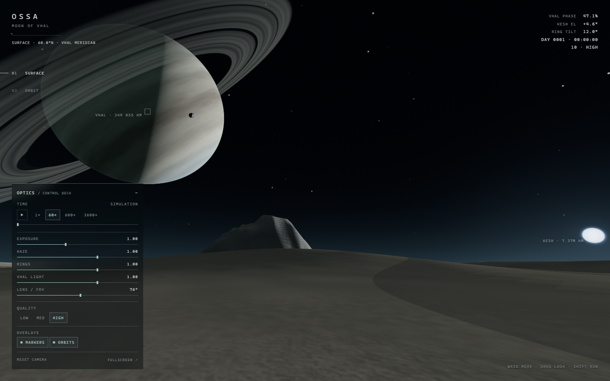

# OSSA — a desert moon beneath Vhal

A self-contained real-time 3D scene, written in Rust and compiled to WebAssembly,
rendered with WebGL2. No textures, no external assets, no tracking: every cloud
band, ring gap, star and grain of the desert is procedural.

**Live:** https://sovlyn.github.io/alien_visit/



> The giant does not set here.

## The scene

You stand on **Ossa**, a tidally locked desert moon of the gas giant **Vhal**.
Vhal hangs over the desert, its rings a thin blade across the sky. A small, cold
star, **Kesh**, sits low on the horizon. The planet's night side is lit only by
ring-shine; the desert is eroded, mineral, and quiet.

The system is hierarchical and physically motivated:

- Kesh (star) → Sur, Vhal, Nadir (planets); Nadir → Cinder; Vhal → Thren, Ossa, Sable.
- Keplerian orbits (eccentricity, inclination, node, periapsis) solved each frame.
- Ossa is tidally locked; Vhal's rings lie in its equatorial plane, tilted 50°
  from Ossa's orbit.
- Eclipses, transits, ring shadows and planet shadows are geometric, not painted.
- The initial epoch is solved from the observer geometry, not screen-space
  placement. The opening has Vhal at +29.6°, Kesh at +4.6°, 86.5° azimuth
  separation, 47.1% Vhal illumination, 12° ring opening, and both bodies on screen.

Switch to **Orbit** to see the local Vhal system: half-lit cloud bands, ring
shadows across the clouds, moons on their arcs. The **SYSTEM** and **KESH**
presets pull back to the star and the planets; true-scale planets are tiny, so
quiet labels and orbit lines carry the hierarchy. Orbit lines are occluded by
bodies, not drawn over them.

## Screenshots

| | |
|---|---|
| [Surface, no UI](docs/shots/surface.png) | [Orbit, no UI](docs/shots/orbit.png) |
| [Surface with HUD](docs/shots/surface-hud.png) | [Orbit with HUD / ORBIT KEY](docs/shots/orbit-hud.png) |
| [SYSTEM focus](docs/shots/system.png) | [Kesh eclipse marker](docs/shots/eclipse.png) |
| [Terrain-occluded Kesh](docs/shots/occluded.png) | [Both bodies off-screen](docs/shots/arrows.png) |
| [Mobile portrait](docs/shots/mobile.png) | |

## Controls

| Input | Surface | Orbit |
|---|---|---|
| `W A S D` / arrows | walk | — |
| `Shift` | run | — |
| drag / pointer lock | look | orbit around focus |
| scroll / pinch | FOV | zoom |
| `1` / `2` | surface / orbit | surface / orbit |
| `Space` | pause | pause |
| `H` | hide UI | hide UI |
| `M` / `O` | markers / orbits | markers / orbits |
| `R` | reset camera | reset camera |
| `F` | fullscreen | fullscreen |

The **OPTICS** deck sits bottom-left on desktop (bottom-right, collapsed, on
mobile) and controls time flow and scrubbing, exposure, haze, ring brightness,
Vhal-shine fill, lens/FOV, quality, focus presets, orbit key and overlays. Every
control is wired to a visible render change.

### HUD

- Vhal and Kesh always carry a quiet position marker when on screen. Kesh gets a
  28px bracket around its disc.
- If a body is behind terrain or another body, its marker turns amber and
  dashed, with `OCCLUDED` / `ECLIPSED`.
- If a body is outside the frame (including behind the camera), a chevron appears
  at the screen edge pointing toward it, with distance.
- In orbit view, the other moons/planets get dim labels plus an ORBIT KEY; the
  default Vhal-local view intentionally leaves Kesh off-screen with an arrow.
- Telemetry: Vhal phase, Kesh elevation, ring tilt, simulation clock, FPS and
  active quality.

## Why it looks the way it does

The opening composition is physically constrained: the illuminated fraction of
Vhal is `(1 − cos elongation)/2`. A low sun near the giant would make it a
narrow crescent; to show both the cloud bands and the low sun, the scene places
Vhal at +30° and Kesh at +5° with ~87.5° elongation — a half-lit giant. The view
is deliberately wide (76° vertical) so both bodies sit near opposite edges of
the frame. The spec records the one physical correction and the orbit-layout
change in its changelog; see `VISUAL_SPEC.md`.

The renderer uses analytic impostors (ray–sphere/ray–plane in a fragment shader)
for the sky and a camera-following polar terrain mesh with a directional shadow
map. All positions are camera-relative f32 kilometres; the simulation is f64.
No textures are used, and the whole page remains self-contained after load.

## Build

Requirements: Rust (stable, edition 2024), the `wasm32-unknown-unknown` target,
and [Trunk](https://trunkrs.dev/).

```bash
rustup target add wasm32-unknown-unknown
cargo install trunk
trunk serve --release --public-url ./
```

Production build:

```bash
trunk build --release --public-url /alien_visit/   # GitHub Pages project path
# or for a local static server at the root:
trunk build --release --public-url ./
python -m http.server 8788 --directory dist
```

## Deploy

The live site is served from the **`gh-pages` branch** (static `dist/` at the
branch root, relative asset paths, `.nojekyll`). Pages is configured with
`build_type: legacy` and source `gh-pages`; this avoids a CI-side dependency on
GitHub Releases at delivery time.

`.github/workflows/pages.yml` contains the equivalent Trunk build and wasm-bindgen
install for CI. It is currently **disabled** because GitHub-hosted runners in this
environment repeatedly received `504` while downloading the prebuilt
wasm-bindgen archive; the same source builds cleanly locally (and the workflow
pins a crates.io-installed CLI as a mitigation). To update the live site:

```bash
trunk build --release --public-url ./
# copy dist/* to the root of the gh-pages branch, add .nojekyll, commit, push
```

The final live URL was verified with the same 28-check Playwright acceptance
suite as the local build.

## Quality / performance

Measured numbers and methodology are in `PERF.md`. Summary from the final build:

- Headless Chrome **hardware**: 1440×900 HIGH surface and orbit both sit at the
  ~240 Hz headless rAF cap (≈4.2 ms/frame or better); the number is a headroom
  indicator, not a device benchmark.
- **SwiftShader software lower bound**: 1440×900 HIGH surface/orbit ≈10 FPS;
  mobile 390×844 LOW at 4× CPU throttle ≈13–16 FPS average across runs.
- Mobile user agents auto-select **LOW** (render scale 0.75, DPR cap 1.25,
  192×128 terrain, 1024² shadows, 3 sky octaves); desktop defaults to HIGH.
  LOW/MED/HIGH remain selectable.
- Page weight ≈366 KB total; WASM 282 KB (126 KB gzip), JS 60 KB (10 KB gzip).
- The HIGH terrain mesh rebuild (≈42–46 ms in the latest four-build sample;
  earlier builds measured ≈58 ms) occurs only when the player moves 96 m or
  changes quality, not while standing or orbiting. This is the largest known
  frame-time spike.

## Repository map

```
src/main.rs            bootstrap, RAF loop, URL/debug hooks
src/settings.rs        shared settings + UI event vocabulary
src/frame.rs           camera/render/HUD frame contract
src/terrain_field.rs   deterministic desert height field
src/scene/             ephemerides, cameras, input, visibility, HUD data, tests
src/render/            GL wrapper, analytic sky, terrain + shadows, orbit lines
src/ui/                DOM instrument panel and HUD overlay
VISUAL_SPEC.md         director's visual spec and acceptance checklist
ARCHITECTURE.md        module ownership and interface contracts
PERF.md                measured performance and caveats
DELIVERY.md            task breakdown, spec changes, acceptance evidence
```

## Verification

- `cargo check --target wasm32-unknown-unknown` and `trunk build --release` pass.
- `tools/qa/acceptance.mjs` — **28/28 checks pass**, console clean: sliders,
  quality, time/pause/scrub, view/focus, keyboard, deck, drag-look, debug API,
  markers/orbits, mobile auto-LOW and joystick.
- `tools/qa/README.md` documents the local screenshot/perf harness.
- The final Pages URL is verified with the same Playwright harness and with
  `curl` for asset availability.

## Credits

Director / visual spec / integration: project lead.
Implementation subagents: renderer-sky, renderer-terrain, scene, ui, qa.
See `DELIVERY.md` for the task breakdown and spec-change log.
